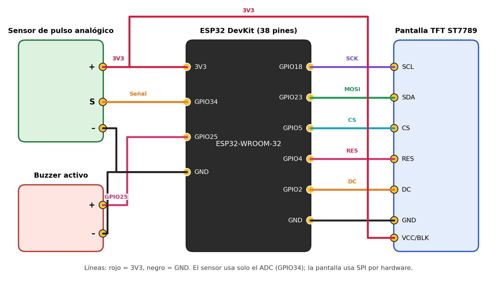
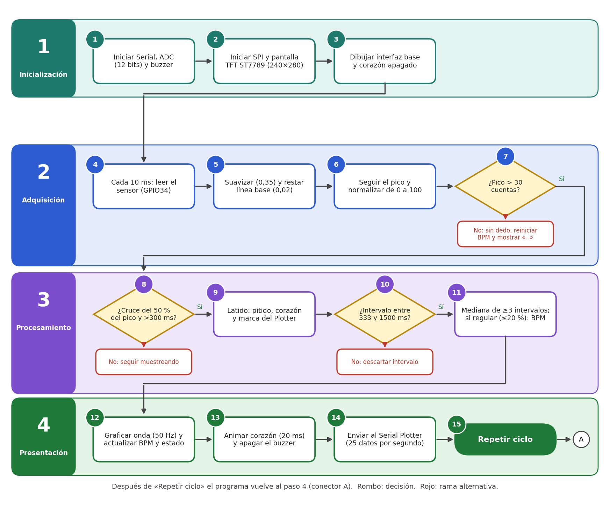

# Monitor de pulso cardíaco con ESP32, sensor de pulso analógico y pantalla TFT ST7789

## Introducción

Este proyecto presenta un monitor de pulso cardíaco educativo basado en un **ESP32**, un **sensor de pulso analógico** y una **pantalla TFT ST7789** de 1,69". El sistema lee la señal del sensor, detecta cada latido, calcula la frecuencia cardíaca en BPM y la muestra en pantalla junto con la onda de pulso, un indicador de latido y, en la versión 2, un aviso sonoro.

Fue desarrollado por estudiantes de la **Fundación Universitaria de San Gil – UNISANGIL, sede Yopal** (Yopal, Casanare, Colombia):

- Cristian Enrique Cruz Fernandez
- Samuel Felipe Diaz Galindo
- Santiago Reina Socha

## Descripción

El sensor entrega una tensión que cambia con cada latido, porque la cantidad de luz que regresa desde la yema del dedo varía con el volumen de sangre (fotopletismografía, PPG). El ESP32 muestrea esa señal a 100 Hz con su ADC de 12 bits, la procesa y presenta los resultados en la pantalla TFT y en el **Serial Plotter** de Arduino.

A diferencia del montaje con MAX30102, este sistema usa un solo canal, por lo que **no mide SpO₂**. Se desarrollaron **dos versiones** del prototipo, que se describen más adelante.

## Videos de funcionamiento

Haz clic en la imagen para ver cada video.

<table>
<tr>
<td align="center" width="50%">

### Versión 1
*Círculo rojo como indicador de latido, sin buzzer.*

</td>
<td align="center" width="50%">

### Versión 2
*Corazón animado en dos tiempos y buzzer en cada latido.*

</td>
</tr>
</table>

## Componentes

- ESP32 DevKit (38 pines)
- Sensor de pulso analógico HW-827
- Pantalla TFT ST7789 de 1,69" (240×280 px)
- Buzzer activo (solo versión 2)
- Placa de expansión para ESP32
- Cables Dupont jumpers hembra-hembra
- Cable USB
- Computador con Arduino IDE

| ESP32 | Pantalla TFT ST7789 | Sensor de pulso |
| --- | --- | --- |
|  |  |  |

| Buzzer activo | Placa de expansión | Cables jumpers |
| --- | --- | --- |
|  |  |  |

## Conexiones

### Sensor de pulso → ESP32

| Sensor | ESP32 |
| --- | --- |
| + (VCC) | 3,3 V |
| S (señal) | GPIO34 |
| – (GND) | GND |

### Buzzer activo → ESP32 (versión 2)

| Buzzer | ESP32 |
| --- | --- |
| + | GPIO25 |
| – | GND |

### TFT ST7789 → ESP32

| TFT | ESP32 |
| --- | --- |
| SCL (SCK) | GPIO18 |
| SDA (MOSI) | GPIO23 |
| CS | GPIO5 |
| DC | GPIO2 |
| RES | GPIO4 |
| VCC / BLK | 3,3 V |
| GND | GND |

> Las etiquetas SDA y SCL de la pantalla corresponden a MOSI y SCK del bus SPI. Confirme el pinout impreso en cada módulo antes de energizar el circuito; el diagrama supone una ESP32 DevKit de 38 pines.

## Diagrama de conexiones

## Diagrama de flujo

El firmware se organiza en cuatro etapas y quince pasos: inicialización, adquisición, procesamiento y presentación.

## Versiones del prototipo

| Aspecto | Versión 1 | Versión 2 |
| --- | --- | --- |
| Indicador | Círculo rojo de 150 ms | Corazón animado en dos tiempos |
| Aviso sonoro | No tiene | Buzzer de 40 ms por latido |
| Serial Plotter | Pulso y BPM, 100 datos/s | Pulso y BPM, 100 datos/s *(el código mejorado agrega Latido y Techo a 25 datos/s)* |
| Procesamiento y BPM | Igual | Igual |

## Funcionamiento

Al energizar el sistema, la pantalla muestra:

- La frecuencia cardíaca en **BPM**.
- La **onda de pulso** dibujada en tiempo real.
- El **estado** de la lectura (colocar el dedo, midiendo o leyendo).
- Un **indicador de latido**: un círculo rojo en la versión 1 y un corazón que late en dos tiempos (*lub-dub*) en la versión 2, que además suena con el buzzer.

Si no hay dedo sobre el sensor, el indicador se apaga y el BPM muestra «--». Cuando pasan 3 segundos sin latidos, la lectura caduca y se reinicia. El primer BPM tarda entre 5 y 8 segundos.

## Procesamiento de las mediciones

### ❤️ Frecuencia cardíaca (BPM)

Cada latido se detecta cuando la señal pulsátil cruza de forma ascendente un umbral adaptativo, igual al 50 % del pico, con un periodo refractario de 300 ms para evitar dobles conteos. Los intervalos válidos (333 a 1500 ms) se guardan en un buffer de 6 valores. Con al menos 3 se calcula la mediana y, si la desviación media respecto a ella es de 20 % o menos, se obtiene `BPM = 60000 / mediana`, suavizado con 40 % del valor nuevo y 60 % del anterior.

### 📈 Señal de pulso

La señal se suaviza con un filtro exponencial (coeficiente 0,35) y se le resta una línea base lenta (coeficiente 0,02). Lo que queda es la componente pulsátil, que se normaliza de 0 a 100 para dibujarla en la pantalla.

### 👆 Detección del dedo

Un seguimiento del pico de la señal decide si hay dedo: se considera presente cuando el pico supera 30 cuentas.

### 🔔 Aviso por latido

En la versión 2, en cada latido el corazón crece y se contrae en dos tiempos y el buzzer suena durante 40 ms, sin bloquear el programa.

| Parámetro | Valor |
| --- | --- |
| Muestreo | 100 Hz |
| ADC | 12 bits, 11 dB |
| Suavizado | 0,35 |
| Línea base | 0,02 |
| Amplitud mínima (dedo) | 30 cuentas |
| Umbral de latido | 50 % del pico |
| Refractario | 300 ms |
| Intervalo válido | 333–1500 ms (180 a 40 BPM) |
| Intervalos usados | 6 (mínimo 3) |
| Regularidad | ≤ 20 % |
| Caducidad | 3 s |

## Serial Plotter

1. Conecta el ESP32 al computador con el cable USB.
2. Abre el Arduino IDE y selecciona la placa **ESP32 Dev Module** y el puerto correspondiente.
3. Sube el código de la versión que quieras probar.
4. Abre **Herramientas → Serial Plotter**.
5. Selecciona la velocidad **115200 baudios** y coloca el dedo sobre el sensor.

Se grafican las series `Pulso` y `BPM`. Con `MODO_PLOTTER=false` el Monitor Serie muestra texto con el valor crudo (`Raw`).

## Librerías

- `Adafruit GFX Library`: gráficos en la pantalla.
- `Adafruit ST7735 and ST7789 Library`: control de la pantalla ST7789.
- `SPI`: comunicación con la pantalla.

La detección de latidos y el cálculo de BPM son propios y no dependen de bibliotecas del sensor.

## Código

| Versión | Archivo |
| --- | --- |
| Versión 1 | [Monitor_Pulso_V1.ino](Monitor_Pulso_V1.ino) |
| Versión 2 | [Monitor_Pulso_V2.ino](Monitor_Pulso_V2.ino) |

### Código mejorado

La carpeta [`codigo_mejorado`](codigo_mejorado) contiene una variante de cada versión con un procesamiento más robusto, pensada para cuando la lectura de BPM sale inestable:

- **Detección por pendiente de subida:** el latido se detecta por la subida más empinada de la señal, que no se confunde con la deriva lenta de la línea base ni con el segundo «bulto» de la onda de pulso.
- **Refractario adaptativo** (60 % del intervalo habitual, mínimo 300 ms) y rearme tras cada latido.
- **Muestreo a periodo fijo** y promedio de 4 lecturas del ADC.
- **Gráfica con filtro propio** de dos etapas y escala mínima, para que el ruido no se amplifique.
- La versión 2 mejorada además envía las series `Latido` y `Techo` al Serial Plotter a 25 datos/s.

| Versión | Archivo |
| --- | --- |
| Versión 1 mejorada | [Monitor_Pulso_V1_mejorado.ino](codigo_mejorado/Monitor_Pulso_V1_mejorado.ino) |
| Versión 2 mejorada | [Monitor_Pulso_V2_mejorado.ino](codigo_mejorado/Monitor_Pulso_V2_mejorado.ino) |

## Documento

Informe completo en formato IEEE, con materiales, objetivos, parámetros y el código explicado bloque por bloque:

[Informe_Monitor_Pulso_IEEE.docx](Informe_Monitor_Pulso_IEEE.docx)

## Archivos

- `Monitor_Pulso_V1.ino`: código de la versión 1.
- `Monitor_Pulso_V2.ino`: código de la versión 2.
- `codigo_mejorado/`: variantes con procesamiento mejorado.
- `DIAGRAMA_DE_CONEXIONES.png`: diagrama de conexiones del montaje.
- `FLUJO_DEL_MONITOR_DE_PULSO.png`: diagrama de flujo del firmware.
- `Informe_Monitor_Pulso_IEEE.docx`: informe del proyecto.
- `videos/`: videos de funcionamiento de las dos versiones.
- `imagenes/`: fotos de los componentes y miniaturas de los videos.
- `README.md`: documentación del proyecto.

## Posibles mejoras

- Comparar las lecturas con un instrumento de referencia.
- Guardar los datos en una memoria o tarjeta SD.
- Enviar los datos por Bluetooth o Wi-Fi.
- Crear una interfaz web para ver la señal.
- Llevar un registro histórico de las mediciones.
- Agregar un indicador de calidad de la señal.

## Nota

Este es un proyecto académico y experimental. **No es un dispositivo médico certificado** y no debe usarse para diagnóstico ni para tomar decisiones clínicas. Sus resultados dependen del contacto del dedo y de la calidad de la señal.
